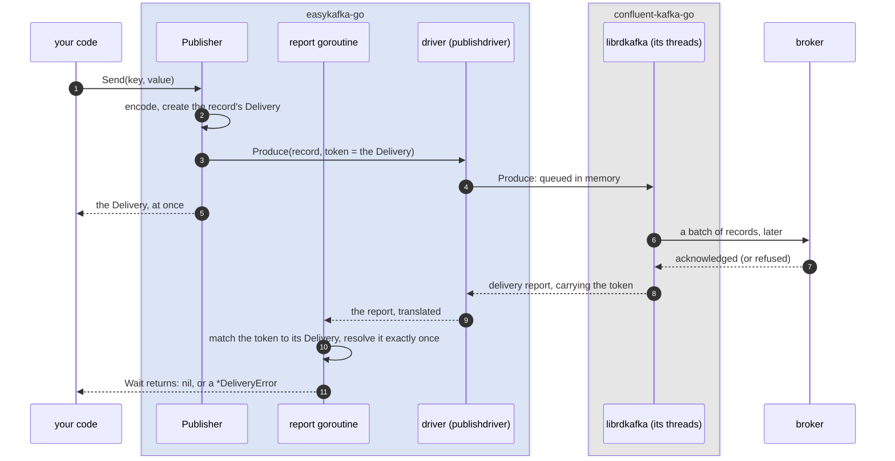
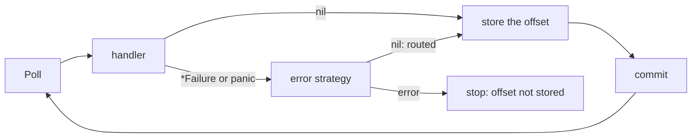

# How easykafka-go works

This document is for a developer deciding whether to rely on this library, and it assumes you would
rather understand the machinery than take the README's word for it. It covers what the library
promises, how it keeps those promises, what it does when things go wrong, and why it is built the
way it is.

The [README](README.md) is the quick start; the package documentation for
[`subscribe`](https://pkg.go.dev/github.com/easykafka/easykafka-go/subscribe) and
[`publish`](https://pkg.go.dev/github.com/easykafka/easykafka-go/publish) is the reference. This is
the middle: enough to trust it, or to know precisely what you distrust.

---

## 1. Two packages, two promises

The library has two sides, and each has a word for what it does and a different word for what the
Kafka client underneath does. The difference between the two words is the library's promise.

| | What the library promises | What the Kafka client does |
|---|---|---|
| **Reading** | A `subscribe.Subscriber` *subscribes*: every record reaches your handler, a failure reaches the error strategy, and a record's offset is stored only once it has been handled or routed | Its driver's `Consumer` *consumes*: `Poll` hands over the next record, and nothing more |
| **Writing** | A `publish.Publisher` *publishes*: a record counts only once the broker has acknowledged it, and one that is not is reported to you, never lost silently | Its driver's `Producer` *produces*: it hands a record to librdkafka, and learns the outcome later |

So when this document says *produce* or *consume*, it means the client's half-step; *publish* and
*subscribe* mean the whole step, with the guarantee. Kafka's own terms stay where they are Kafka's: a
`Subscriber` joins a *consumer group*, set with `WithConsumerGroup`.

---

## 2. librdkafka in a few facts

Both sides run on [confluent-kafka-go](https://github.com/confluentinc/confluent-kafka-go), a Go
wrapper around librdkafka, the C client. You need only a few facts about it to follow the rest.

* **It runs its own threads.** librdkafka connects, batches, sends, retries and reconnects on
  background threads. The Go calls do not do network work themselves; they hand things to those
  threads through queues and read results back through queues.
* **Producing only queues a record locally.** `Produce` returns as soon as the record is in
  librdkafka's in-memory queue, before anything reaches the network. librdkafka sends it later, in a
  batch with others, and retries it on its own if the broker is unavailable. The outcome arrives
  afterwards as a *delivery report*. So a record is **not written** when `Produce` returns, and a
  process that exits at that point loses whatever is still queued. Everything in [§3](#3-how-publishing-is-made-durable)
  exists because of this.
* **`acks` decides what an acknowledgement means.** With `acks=all` the broker acknowledges a record
  only once every in-sync replica has it; with `min.insync.replicas=2` on the topic, an acknowledged
  record survives losing a broker. With `acks=1`, only the partition leader has it.
* **A record has a deadline.** `message.timeout.ms` bounds how long librdkafka keeps trying to
  deliver one record, retries included. Past it, the delivery report says it failed.
* **Idempotence makes retries safe.** Without it, a retry after a lost acknowledgement can write a
  record twice, and retries can reorder records within a partition. With it, the broker discards
  the duplicate and keeps the order.
* **On the reading side, `Poll` is where everything happens.** Records, errors, and the rebalance
  callbacks that assign and revoke partitions all arrive through `Poll`, on the goroutine that calls
  it.
* **Storing an offset is not committing it.** The *offset store* is librdkafka's local note of how
  far this consumer has got; a *commit* sends that note to the consumer group, where it survives a
  restart. The two are separate steps, and [§4](#4-how-subscribing-works) depends on that.

---

## 3. How publishing is made durable

### One record, start to finish

Every record you write gets a **`Delivery`**: a small object the library creates for that record
alone, which will hold its outcome once the broker has answered. Until then it is empty. `Send`
hands it to you straight away; its `Wait` method blocks until the outcome is there and returns it:
nil if the broker acknowledged the record, or a `*DeliveryError` saying why not. `Publish` is simply
`Send` followed by `Wait`. Getting the outcome into the right `Delivery` is the publisher's job, and
the diagram shows how it does it.



The blue box is this library: the `Publisher` your code calls, the *report goroutine*
each publisher starts in `New` and runs until `Close`, and the *driver*, the only code that talks to
confluent-kafka-go. A goroutine inside the driver turns confluent's events into the library's own
report type and passes them on. librdkafka runs on its own threads beneath confluent-kafka-go.

* **The token is the record's own `Delivery`.** librdkafka lets the caller attach an opaque value,
  a *token*, to each record it produces, and hands it back untouched on that record's delivery
  report. The publisher attaches the record's `Delivery`, so the report goroutine knows which
  `Delivery` a report belongs to without a lookup table. Each `Delivery` resolves exactly once; a second report for the same record would be
  a bug in the library or librdkafka, so it is logged (`EK_PUBLISH_UNMATCHED_REPORT`) and dropped.
* **One goroutine reads every report**, per publisher. It resolves the `Delivery`, and for a failed
  record also calls the function given to `WithDeliveryErrorFunc`, whether or not anyone is waiting.
  That is why the callback must not block: every later report waits behind it.
* **`Publish` is `Send` followed by `Wait`.** It returns nil once the broker has acknowledged the
  record. `Send` returns at once; the error it can return covers only local failures (encoding, a
  full queue, a closed publisher). To write many records, `Send` them all and wait once with
  `WaitAll`: one round of broker round trips for the lot, rather than one per record.
* **A full queue fails at once.** If librdkafka's queue has no room, `Send` returns `ErrQueueFull`
  rather than blocking your goroutine.
* **Abandoning a wait does not cancel the record.** If the context passed to `Wait` or `Publish`
  ends first, the call returns the context's error, but the record may still be delivered, and it is
  still reported.

### The defaults, and what they survive

A publisher starts with `acks=all`, idempotence on, and a **30 s delivery timeout**. Measured on a
three-broker cluster with replication factor 3 and `min.insync.replicas=2`:

| Situation | What a publisher with the defaults does |
|---|---|
| One broker restarted at a time (a rolling update) | No failures. Latency rises while leaders move; the worst measured was 1.05 s |
| One broker crashes | No failures. Writes to partitions it followed stall for about 10 s, until the cluster notices it is gone; the 30 s timeout covers that three times over |
| Two brokers down | Every write fails, once the delivery timeout has passed, as `ErrDeliveryTimeout` |

The first two are what the defaults are for. The third is beyond what `min.insync.replicas=2` can
give, and the library's job there is only to fail clearly rather than hang. `WithAcksLeader` would
keep writing on one surviving broker, at the cost of losing what that broker had not yet
replicated.

### Shutdown and fatal errors

* **`Close` delivers, then reports.** It stops accepting records, then waits, until its context
  ends, for librdkafka to deliver what it still holds. Whatever is left then is *purged*: each such
  record is reported as not delivered (`ErrNotDelivered`), through its `Delivery` and the callback,
  rather than dropped silently. Close a publisher after whatever produces records has stopped, with a
  context of its own: at shutdown your application's root context is usually cancelled already.
* **A fatal error is final.** A few rare errors, mostly around idempotence, leave a producer unable
  to write. The publisher records the first one, and from then on every write fails with `ErrFatal`,
  `Err` returns it, and `Ping` reports it. It does not quietly rebuild itself: an event that needs an
  operator should not be hidden. Wire `WithFatalHandler` to a graceful shutdown and `Err` into a
  liveness probe, and the process restarts with a fresh publisher.

---

## 4. How subscribing works

### The poll loop

One goroutine, the one that calls `Start`, runs the whole loop:



* **The handler returns `*Failure`, not `error`.** nil means success. A panic is recovered and
  treated as a failure.
* **The error strategy decides what a failure means.** `Skip` logs it and moves on (the default),
  `FailFast` stops the subscriber, and `Retry` republishes the record to a retry topic with its
  attempt count and due time in headers, and to a dead-letter topic once its attempts are used up or
  at once for a failure wrapping `ErrPermanent`. The library writes to the retry topic but never
  reads it: a second subscriber on that topic, calling `WaitUntilRetryTime`, does the retrying.
* **A strategy that returns an error stops the subscriber.** There is no pause and resume:
  stopping, with the record's offset not stored, is how a strategy says "this cannot be handled
  now".

### Offsets: only what is done gets stored

librdkafka would normally store a record's offset the moment `Poll` hands it over, before your
handler has even run, and a commit would then publish work that never happened. The library turns
that off (`enable.auto.offset.store=false`) and stores each offset itself, **after** the record has
been handled or routed. So a crash at any point can only replay work, never skip it.

A committed offset is where to resume, so the library stores the record's offset plus one: after
handling offset 2, it stores 3, and a restart resumes at offset 3.

By default the store is committed after every record or batch. `WithAutoCommitEvery(d)` hands the
timing to librdkafka, which commits in the background every `d`: fewer round trips, at the cost of
replaying up to `d` of finished work after a crash. Duplicates either way, never loss. On revocation
and at shutdown the library commits whatever is stored, whatever the interval.

### Batches

With `WithBatchHandler` the subscriber polls records into a buffer and hands the handler a batch
once it is full or its timeout has passed. The handler marks each failed record with `item.Fail`;
the subscriber routes each failed record to the strategy on its own. A handler that returns a
`*Failure` instead, or panics, fails the whole batch, and every record is routed under that one
failure. Only when every record of the
batch is resolved, handled or routed, does it store the highest offset of each partition. That
maximum is honest only because nothing in the batch is still undecided.

### Rebalances

The library pins Kafka's *eager* rebalance protocol, in which every partition is revoked at once.
On a revoke the subscriber drops its batch buffer: those records' offsets were never stored, so
whoever owns the partitions next reads them again. Under the *cooperative* protocol only some
partitions are revoked, and dropping the buffer could lose records from the partitions that stay, so
the library refuses cooperative settings rather than lose records quietly.

### Stopping

Cancel the context passed to `Start`. `Start` returns once the loop has exited, the stored offsets
are committed and the connection is closed. A handler running at that moment sees its context
cancelled too, and whatever it returns is routed like any other result.

---

## 5. At-least-once, end to end

Two rules, one on each side, make a service that consumes and publishes at-least-once:

1. **The subscriber stores a record's offset only after its handler has returned.**
2. **A handler that publishes returns only once its records are acknowledged.**

Together: if a write fails, the handler fails, the offset is not stored, and the record is consumed
again. If the process dies mid-handler, the same. A record may be processed twice; it is never
processed zero times.

The handler waits under `context.WithoutCancel(ctx)`. Otherwise a shutdown that cancels `ctx` would
abandon a record that was about to be confirmed; the handler would fail, the record would be
consumed again after the restart, and the write would happen twice. The delivery timeout still
bounds the wait.

**The retry strategy follows the same rule.** It writes retry and dead-letter records through a
`Publisher` of its own, sends all the records of a failure, then waits once for every
acknowledgement, and only then lets the subscriber store the source offset. If a retry or DLQ write
fails, `HandleError` fails and the subscriber stops, with the offset not stored. A failed write is a
stopped consumer, loud and recoverable, never a silently lost message.

---

## 6. Drivers and fakes

```
subscribe.Subscriber ──► subscribedriver.Consumer ──► confluent-kafka-go
publish.Publisher    ──► publishdriver.Producer   ──► confluent-kafka-go
```

* **One driver per side is the only code that touches confluent-kafka-go.** The public types are
  written against the driver's interface, not against librdkafka, so confluent's types never reach
  the public API.
* **That interface is what the unit tests replace.** `WithConsumerFactory` and
  `WithProducerFactory` swap the real driver for a scripted fake (`FakeConsumer`, `FakeProducer`),
  so the unit tests drive the real `Subscriber` and the real `Publisher` (dispatch, offset storing,
  delivery resolution, callbacks, shutdown) in milliseconds, with no broker. A fake decides exactly
  which records arrive, which calls fail, and which reports come back in which order, which a real
  broker cannot be made to do reliably.
* **The seams are for this module only.** Their argument types live under `internal/`, which Go
  forbids other modules to import, so no application can depend on them.
* **What a fake cannot prove, the integration tests do.** They run against real brokers in Docker:
  one broker for most tests, three for the outage tests, which stop, kill and restart brokers under
  load and check that nothing acknowledged is lost.
* **A test guards the boundaries.** `tests/unit/architecture` parses every import in the library
  and fails if confluent-kafka-go is imported anywhere but the two drivers, if the publish side
  imports the subscribe side, or if a package belongs to neither side.

---

## 7. Design decisions, and what they cost

**The publisher waits for acknowledgements rather than trusting the queue.**
*Buys:* "returned nil" means "the broker has it". A failure always reaches someone: the caller, the
callback, or both.
*Costs:* a broker round trip per `Publish`. `Send` and `WaitAll` spread it over many records.

**`acks=all` and idempotence are on by default.**
*Buys:* an acknowledged record survives losing a broker, and the retries every rolling update causes
neither duplicate nor reorder records.
*Costs:* a little latency per record, and the rare fatal idempotence error, which needs a restart.
`WithAcksLeader` and `WithoutIdempotence` exist as escape hatches.

**A strategy error stops the subscriber; there is no pause or resume.**
*Buys:* one simple rule: a record that cannot be resolved is never stepped over.
*Costs:* an outage downstream stops consumption entirely until the service restarts. A strategy
cannot ask to wait and try again later.

**The library owns the offset store.**
*Buys:* an offset is stored only for finished work, so every commit, including librdkafka's own
background ones, is safe.
*Costs:* the library, not librdkafka, is responsible for storing every offset correctly; the tests
pin it.

**The eager rebalance protocol only.**
*Buys:* a revoke drops the whole batch buffer, which is simple and provably safe.
*Costs:* every rebalance pauses the whole group for a moment. Cooperative rebalancing would need the
buffer and the revoke handling to become partition-aware.

**One partitioner per publisher, and no explicit partition per record.**
*Buys:* keys always land where every other writer using the same partitioner puts them, which is
what keeps a key's records in order.
*Costs:* a service that needs two partitioners creates two publishers; a record cannot be sent to a
chosen partition.

**Concrete `*Subscriber` and `*Publisher`, not interfaces.**
*Buys:* the documentation shows on the types, and the library can add methods without breaking
anyone.
*Costs:* code that wants to mock them declares its own small interface, such as `Start(ctx) error`.

**A handler waits for its writes, rather than the subscriber tracking them.**
*Buys:* at-least-once with no new offset bookkeeping: the existing rule, "store after the handler
returns", is enough.
*Costs:* a handler that publishes on every record processes records one round trip at a time. The
alternative, letting the handler `Send` without waiting and storing offsets only behind confirmed
writes, is possible but not built.

---

## 8. What is deliberately not built

* **Transactions and exactly-once.** The library is at-least-once on both sides. Exactly-once needs
  transactional producers and read-committed consumers, a different model with different costs.
* **Pausing and resuming consumption.** A strategy can only let a record through or stop (§4).
* **Cooperative rebalancing.** Refused, for the reason in §4.
* **An explicit partition per record.** Could be added later as a per-call option.
* **Asynchronous offset tracking behind outstanding writes.** The faster form of §5; it waits for a
  service that needs the throughput.
* **Test doubles for applications.** The library's fakes are internal; a `publishtest` or
  `subscribetest` package for services to use has not been built.

---

## 9. Observability

* **Log codes.** The log lines that matter to an operator (a record written off or sent to the DLQ,
  the subscriber stopping, a failed commit, a broker lost and regained) carry a stable code in the
  `ek_code` field, such as `EK_DLQ_WRITE_FAILED` or `EK_PUBLISH_BROKER_DOWN`, so alerts do not
  depend on the wording. The README's *Log codes* table lists every code, what it means and what to do about it.
* **Delivery errors.** `WithDeliveryErrorFunc` hears of every record that was not acknowledged, on
  the publisher and on the retry strategy alike: a hook for metrics and alerts.
* **Health.** `Ping` checks that a broker answers and every bound topic exists, which suits a
  readiness probe; `Err` reports a fatal producer error, which suits a liveness probe.
